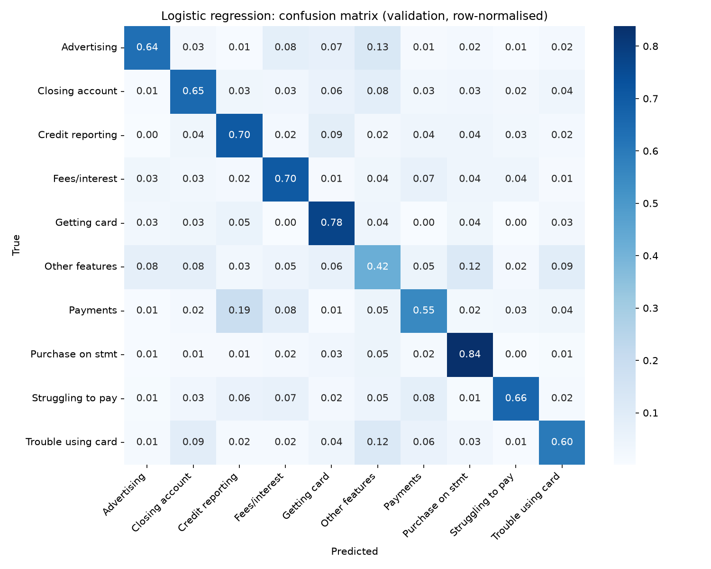

# CFPB Credit Card Complaint Intelligence

Classifying US consumer credit card complaints by issue using NLP — from TF-IDF baselines to transformers and LLM-based extraction.

**Status:** Week 1 complete (TF-IDF baselines). Weeks 2–6 in progress — see [Roadmap](#roadmap).

---

## Business problem

Card issuers receive thousands of free-text complaints. Routing each to the right team, spotting root causes and tracking emerging issues requires understanding the text. This project asks: **how accurately can a model assign a complaint to its issue category from the consumer's narrative alone?**

Why predict a label the consumer already chose?
- Complaints from other channels (email, calls, chat) arrive **without** a category.
- Consumer-chosen categories are **noisy** — a model can flag likely mislabels.
- The same text understanding feeds later stages (LLM extraction, monetary-relief prediction).

## Data

- **Source:** CFPB Consumer Complaint Database, public BigQuery snapshot (`bigquery-public-data.cfpb_complaints`), data to **2023-03-23**.
- **Scope:** credit card complaints (general-purpose/charge cards and store cards) **with a consumer narrative**.
- **New taxonomy only:** the CFPB changed its product and issue categories in **April 2017**. Mixing old and new labels would give contradictory targets (e.g. "Late fee" vs "Fees or interest"), so only post-change complaints are used: **81,996 complaints**.
- **Labels (10 classes):** 6 credit-report issues merged into one `Credit reporting` class (see Key findings).

| Class | Complaints |
|---|---|
| Problem with a purchase shown on your statement | 22,272 |
| Other features, terms, or problems | 10,960 |
| Fees or interest | 9,783 |
| Getting a credit card | 8,589 |
| Problem when making payments | 8,144 |
| Closing your account | 6,587 |
| Advertising and marketing, including promotional offers | 5,325 |
| Credit reporting (merged) | 4,931 |
| Trouble using your card | 3,935 |
| Struggling to pay your bill | 1,470 |

**Time-based split** (out-of-time validation — the model is trained on the past and applied to the future):

| Split | Period | Complaints |
|---|---|---|
| Train | Apr 2017 – Dec 2020 | 45,102 |
| Validation | 2021 | 14,652 |
| Test | Jan 2022 – Mar 2023 | 22,192 |

## Method (Week 1)

1. **Cleaning:** removed CFPB privacy masks (`XXXX`, `XX/XX/XXXX`), replaced amounts (`{$450.00}`) with a `dollar_amount` token, lowercased, dropped 50 complaints with fewer than 5 words.
2. **Features:** TF-IDF on unigrams + bigrams (`min_df=5`, `max_df=0.9`, `sublinear_tf=True`), giving 168,964 features, fitted on train only.
3. **Models:** multinomial logistic regression and multinomial Naive Bayes.
4. **Tuning:** all choices made on the **validation** set; the test set was scored **once** at the end.
5. **Metric:** **macro-F1** (classes are imbalanced ~15×; macro-F1 weights each class equally). Accuracy reported alongside.

## Results

| Model | Valid macro-F1 | Valid accuracy | **Test macro-F1** | **Test accuracy** |
|---|---|---|---|---|
| **Logistic regression** (C=2, `class_weight="balanced"`) | 0.635 | 0.690 | **0.615** | **0.674** |
| Multinomial Naive Bayes (α=0.05, uniform prior) | 0.577 | 0.647 | **0.556** | **0.628** |

- Both models lose only ~0.02 macro-F1 from validation (2021) to test (2022–23): the baseline **generalises to a later period**.
- Logistic regression beats Naive Bayes by ~0.06, consistent with theory: with 45K documents and highly correlated bigram features, a discriminative model outperforms Naive Bayes' independence assumption.



**Most informative terms (logistic regression weights):**
- *Fees/interest:* interest, fee, apr, late fee
- *Struggling to pay:* hardship, bankruptcy, forbearance
- *Trouble using card:* credit limit, declined, blocked
- *Purchase on statement:* dispute, merchant, refund, `dollar_amount`

## Key findings

1. **Taxonomy change (2017).** Old and new CFPB issue lists overlap in meaning but differ in name; using only the new taxonomy avoids contradictory labels in a time-based split.
2. **Label ambiguity in credit-report issues.** "Incorrect information on your report" scored F1 = 0.25 as its own class: it was confused with other credit-report issues *and* scattered across classes describing the underlying cause (payments, new accounts, purchases). Consumers label the **consequence** (a wrong credit report) while the text describes the **cause**. Merging it into `Credit reporting` raised validation accuracy from 0.682 to 0.690.
3. **Naive Bayes smoothing on TF-IDF.** With default add-1 smoothing, Naive Bayes scored 0.30 macro-F1: the pseudo-counts (α × |V| ≈ 169K) swamped the small TF-IDF mass of minority classes, so priors dominated. Tuning α to 0.05 raised it to 0.58.
4. **Class balancing helps both metrics.** `class_weight="balanced"` raised macro-F1 from 0.614 to 0.635 *and* accuracy from 0.682 to 0.690, mainly via recall on small classes (e.g. "Struggling to pay" 0.40 → 0.66).
5. **Errors come from overlapping categories, not noise.** The largest confusion is *Payments → Credit reporting* (19%): "late" is a top term for both (late payments get reported to the bureaus). *Credit reporting ↔ Getting a card* overlap via fraudulently opened accounts ("identity", "opened").
6. **Drift.** "Getting a credit card" nearly doubles its share in the test period (8% → 15%), and "Credit reporting" F1 drops most on test (0.62 → 0.46): topics within credit-report complaints appear to shift over time.

## Limitations

- Labels are **chosen by consumers** and categories overlap, which caps achievable accuracy ("Other features" is a catch-all: F1 ≈ 0.46).
- Data is a **public snapshot ending March 2023**; 2023 is a partial year and recent narratives are under-published.
- Complaints are **not a representative sample** of all customers; no conclusions about any issuer are drawn.
- Bag-of-words features ignore word order beyond bigrams.

## Repository structure

```
sql/          BigQuery queries (exploration, table build, labels, splits)
notebooks/    01_baseline_tfidf.ipynb: cleaning, TF-IDF, LR, NB, evaluation
reports/      figures (confusion matrix)
src/          reusable scripts (later weeks)
eval/         hand labels for LLM evaluation (later weeks)
data/         local data (not in git)
requirements.txt
```

## How to run

1. Run `sql/02_build_table.sql` in BigQuery (creates `cc_complaints` and `cc_model`).
2. Export `cc_model` to `data/cc_model.csv`.
3. `pip install -r requirements.txt` (on Intel Macs, install `cryptography`, `jupyter` and `llvm-openmp` via conda-forge first).
4. Run `notebooks/01_baseline_tfidf.ipynb`.

## Roadmap

- [x] **Week 1:** TF-IDF + logistic regression / Naive Bayes baselines
- [ ] **Week 2:** dense sentence embeddings vs TF-IDF; hand-labelled evaluation set
- [ ] **Week 3:** fine-tuned BERT classifier (PyTorch)
- [ ] **Week 4:** LLM-based extraction of root causes and summaries
- [ ] **Week 5:** LLM evaluation (hallucination checks) and monetary-relief prediction with LLM features
- [ ] **Week 6:** monitoring dashboard and executive summary
